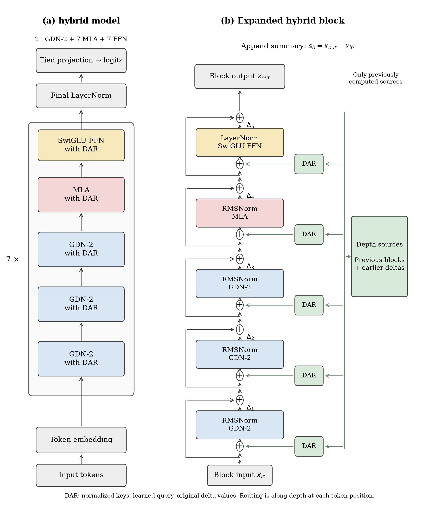
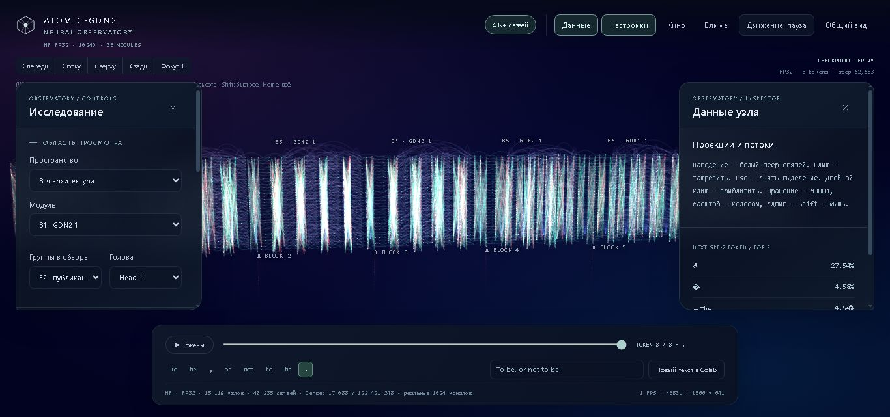
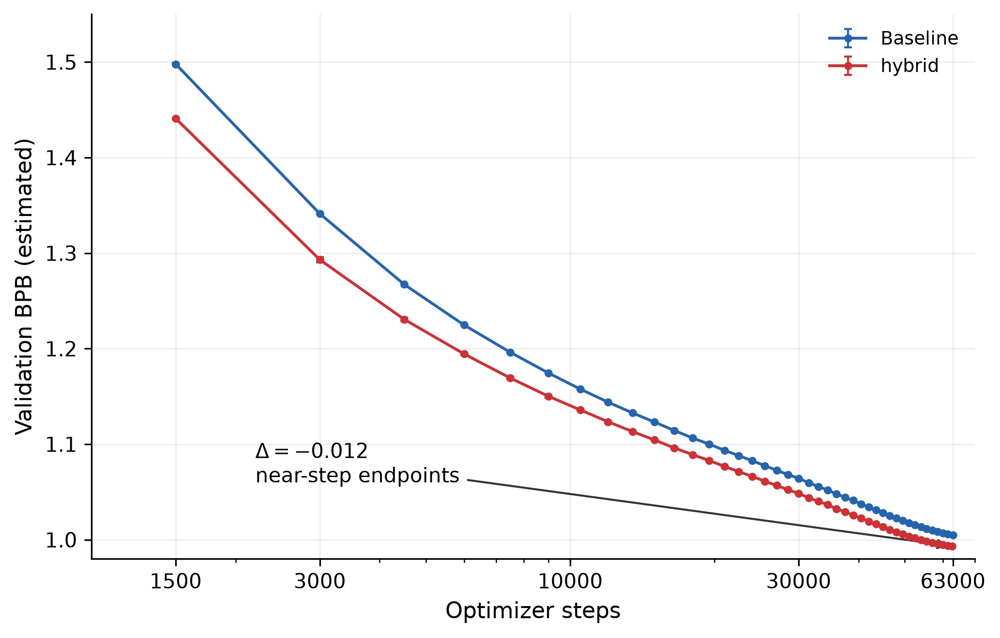

# Atomic-GDN2

**TPU language-model research: pure GDN-2 and a GDN-2/MLA hybrid with hierarchical delta attention residuals.**

[Earlier paper, 16 October](paper/atomic-gdn2.pdf) · [Paper status](paper/README.md) · [Weights](https://huggingface.co/Akseleu/Atomic-GDN2) ·
[Kernel](https://github.com/Akseleu-J/atomic-ops) · [Exact results](attestation/training.json) ·
[Full run evidence](artifacts/four-runs-20261016.zip)



<!-- OBSERVATORY:BEGIN -->
## 🔭 Interactive Observatory

**[Open the 3D checkpoint visualization](https://huggingface.co/spaces/Akseleu/Atomic-GDN2-Observatory)** · [Source and verification](Observatory/) · [Capture new text in Colab](https://colab.research.google.com/github/Akseleu-J/atomic-gdn2/blob/main/Observatory/notebooks/Atomic-Production-Capture.ipynb)

[](https://huggingface.co/spaces/Akseleu/Atomic-GDN2-Observatory)

Hybrid seed 2: **40,235 graph links**, with a lighter-mode toggle. Checkpoint-derived **FP32 serial reference**; grouped overview, selected Dense products and structural dependencies. Eight tokens; individual Dense details are from the final token. Production TPU bf16/fused parity is not established. [Data scope and audit](Observatory/#what-the-data-means).
The official Observatory now includes curved signal strands, activation-based brightness, a pinned white connection fan and compact translucent controls. The underlying audited FP32 capture is unchanged.
<!-- OBSERVATORY:END -->

## What is measured

Four fresh Kaggle TPU v5e-8 runs, two seed settings per model (initialization 1/2; data 43/44; dropout 124/125), batch 32, context 2048.
The **hybrid** combines 21 GDN-2 mixers, 7 MLA mixers and 7 SwiGLU FFNs; the **Baseline** uses
28 GDN-2 mixers and 7 FFNs. Both use the same external `atomic_gdn2` kernel implementation.

| Model | Parameters | BPB_est at exactly 61,500 steps (mean ± sample SD) |
|---|---:|---:|
| Baseline | 334,156,800 | 1.005909 ± 0.000227 |
| hybrid | 307,131,392 | **0.993838 ± 0.000111** |

At this common point both have processed **4,030,464,000 training target tokens**;
Δ (hybrid − Baseline) = **−0.012071 estimated BPB**. Hybrid is lower at all 41 shared logged
evaluation steps in both seeds. Sample SD is computed across two seeds (`ddof=1`), not a confidence interval.



| Target BPB_est ≤ | Fewer tokens to first logged target | Less notebook time |
|---:|---:|---:|
| 1.10 | 18.52% | 13.48% |
| 1.08 | 17.65% | 13.55% |
| 1.06 | 14.29% | 10.38% |
| 1.02 | 16.42% | 12.51% |

Crossing is measured per seed at the first evaluation below the target, without interpolation.
These are measured comparisons of the complete architectures, **not an ablation isolating DAR**.
Models differ in parameters/FLOPs; learning rates follow elapsed time rather than identical step schedules.

### BPB and endpoints

`estimated BPB = token cross-entropy / ln(2) / 4.2`. This is not exact byte-level BPB.
Evaluation covers 4,390,912 target tokens (67 full batches) from the available validation split.
Actual final checkpoints: Baseline seed 1/2 at 65,000; hybrid seeds at 62,673/62,683.
The chosen near-step plot cutoff uses Baseline 63,000; its Δ is −0.011617 BPB and is explicitly
**not exactly token matched**. All original later evaluations are retained in the raw artifacts.

## Architecture and source provenance

Routing follows the scoring/additive equations of [Delta Attention Residuals](https://arxiv.org/abs/2605.18855),
adapted to my block hierarchy: learned zero-initialized query vectors, RMSNorm keys,
softmax over earlier depth sources, original delta values, and retrieval added before mixers and FFN.
Block summaries include the actual FFN-inclusive block change. The previous intra-block Q/K router
is not part of this release. [Architecture](docs/ARCHITECTURE.md).

- Baseline training snapshot: `bf80e315732837c4261f32faebbb052c51dee094`.
- hybrid training snapshot: `697a10d3cf06be5a5b9cafa38fe272629814e64f`.
- Kernel: `0dbc59cf74883315d7adbebe9229c520663e0d58`.
- The present release is a publication snapshot; original source files/hashes are preserved in each run's provenance.
- This is a new repository. The previous repository and its history are preserved as a private archive.

## Use the weights

Weights on Hugging Face use **safetensors with original Flax tensor layout**. They are not a
Transformers `AutoModelForCausalLM` checkpoint. Use this package's loader and matching model config;
see [weights and inference](docs/WEIGHTS.md). No optimizer state is embedded in inference weights.
The models were trained as base language models and are not instruction-tuned.

## Reproduce

Install this project and the pinned external kernel in a compatible JAX/TPU environment.
The exact Linux dependency lock used for training is `scripts/requirements.lock`.

```bash
pip install "atomic-ops @ git+https://github.com/Akseleu-J/atomic-ops@0dbc59cf74883315d7adbebe9229c520663e0d58"
pip install -e .
python -m atomic_gdn2_model.cli --config configs/hybrid_hier_1024_28l.yaml
```

The CLI uses the values in the config; this command alone does **not** reproduce the time-limited
Kaggle setup. For exact batch/seed/deadline/data overrides, use the resolved configs in the run
artifacts and `scripts/training_entry.py`. No training job auto-resumes into the reported timed protocol.
[Reproduction guide](docs/REPRODUCING.md).

## Kernel scope

Both trained architectures use `atomic_gdn2` from kernel commit
`0dbc59cf74883315d7adbebe9229c520663e0d58`.
The separate 17 October four-path benchmark pins
`11616acd8a061768a38feb12c58e5e329952f5d5` and uses zero damping.

| Separate benchmark | Versus the author's OLD scan | Versus the author's JAX_REF WY |
|---|---:|---:|
| Gradient microbenchmark, B4/H6/L2048/D128 | 411.75 ± 5.13× | 34.50 ± 0.43× |
| Complete synthetic 34,873,952-parameter LM step, B8/L2048 | 117.76 ± 0.15× | 4.531 ± 0.004× |

OLD uses block rematerialization in the full step. Timings use synchronized fixed-state
replay, three seeds and sample SD. These ratios are not measured speedups of the
307M/334M models. NEW/JAX_REF update checks pass all three seeds; NEW/OLD update
checks fail for two seeds despite passing recorded full-snapshot norm gates.

[Current benchmark](https://github.com/Akseleu-J/atomic-ops/blob/main/benchmarks/README.md) ·
[Numerical evidence](https://github.com/Akseleu-J/atomic-ops/tree/main/numerical) ·
[Kernel evidence and provenance](docs/KERNEL_EVIDENCE.md).
The linked 16 October paper retains earlier kernel measurements; consult its
[status and errata](paper/README.md) before quoting those numbers.

## Limitations

Two seeds, one corpus, context length 2048, no independent held-out test/downstream evaluation,
no MLA/DAR component ablation, unequal parameter/FLOP budgets and wall-time-dependent LR.
Threshold crossing is quantized by the 1,500-step evaluation grid. Sanitization/clipping activation
frequency was not measured. No universal convergence or production-readiness claim is made.
[Full limitations](docs/LIMITATIONS.md).

## License and citation

Model code is Apache-2.0 licensed. Dataset/tokenizer rights remain with their respective sources.
Use `CITATION.cff` and the accompanying paper. Author: Akseleu Omirbay.
